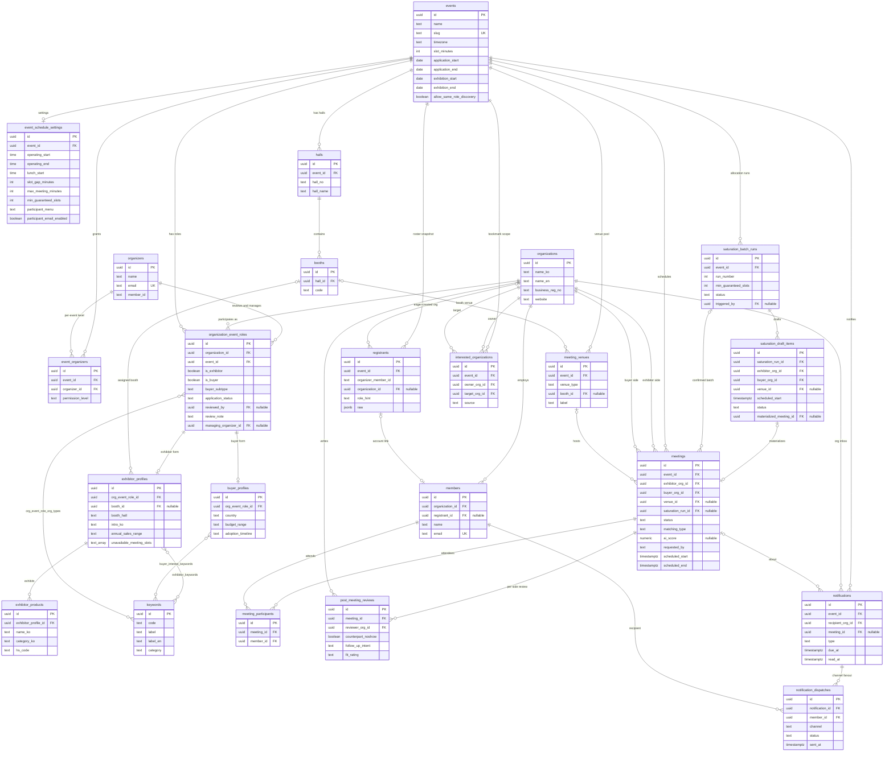

> 📄 **제출용 저장소입니다.** 범위·실행 방법·데모 계정은 [SUBMISSION.md](SUBMISSION.md)를 먼저 확인하세요.

# B2B 비즈매칭 CMS

전시회·박람회의 참가기업과 해외 바이어 사이 1:1 상담 매칭을 운영하는 **CMS**입니다. 참가자가 비즈매칭 신청서를 작성하고, 상대 기업을 탐색해 전시 기간의
상담 슬롯 위에서 미팅을 잡고, 운영자가 명단 적재부터 신청서 심사·배정·미팅 운영까지 콘솔에서
관리합니다. 행사 설정으로 참가자 화면을 '미팅'만 보이게 해 운영자 배정 중심으로 운영할 수도 있습니다.

저장소·코드·문서에 나오는 **NABI**는 개발 코드명입니다.

- **운영 사이트**: https://kcevietnam.salesground.kr
- **적용 행사**: 2026년 10월 20일~22일 행사 운영(주최 마인즈그라운드)
- **구성**: 모노레포 (Next.js 프런트엔드 + FastAPI 백엔드 + PostgreSQL)
- **행사 종속성 없음**: 행사명·타임존·상담 시간·운영시간·열람 정책·참가자 메뉴·알림 메일 발송 여부가
  전부 행사(`events`)와 행사 설정(`event_schedule_settings`) 레코드에서 오므로, 같은 코드베이스로 다른
  행사를 운영할 수 있습니다.

---

## 제출 산출물 대응표

이 저장소에 포함된 산출물의 위치입니다.

| 산출물 | 위치 | 비고 |
|---|---|---|
| ② 소스코드 | [`frontend/`](frontend/) · [`backend/`](backend/) | 애플리케이션 전체 소스 |
| ④ 완료보고서 근거자료 | [`docs/prd/`](docs/prd/) 기능정의서 17건 · [`docs/adr/`](docs/adr/) 아키텍처 결정기록 15건 · [`research/`](research/) 개발보고서 | 기능 ID는 [`docs/page-list.csv`](docs/page-list.csv)의 화면 목록과 1:1 대응 |
| ⑥ 테스트 | 아래 [테스트](#테스트) 절 | 백엔드 1,738건 · 프런트엔드 2,189건 |
| ⑦ DB 스키마·ERD | [`docs/db/schema.sql`](docs/db/schema.sql) · 아래 [데이터 모델](#데이터-모델) 절의 ERD | 필드 정의서는 [`docs/db/schema-spec-v2.xlsx`](docs/db/schema-spec-v2.xlsx) |
| ⑧ API 명세 | 백엔드 기동 후 `/docs`(Swagger UI) · `/openapi.json` | OpenAPI 3.1 자동 생성, 엔드포인트 97개 |
| ⑨ 계정·권한체계 | 아래 [권한 체계](#권한-체계) 절 · [SUBMISSION.md](SUBMISSION.md)의 데모 계정 | 운영자 축(master/sub)과 참가자 축(참가기업/바이어)이 분리 |

---

## 시스템 구성

### 레이어 경계

**FastAPI가 모든 DB 접근·컴퓨트·AI 호출·시크릿을 소유합니다.** Next.js는 DB에 직접 접속하지 않고
FastAPI API만 호출합니다([`docs/adr/0008-platform-stack-aws-and-backend-owns-db.md`](docs/adr/0008-platform-stack-aws-and-backend-owns-db.md)
경계 B). 프런트엔드의 Route Handler(`frontend/app/api/`, 34개)는 세션 쿠키를 읽어 백엔드에
`Authorization: Bearer` 헤더로 중계하는 BFF 계층이며, 자체 DB 드라이버 의존성이 없습니다.

```
 브라우저
    │  (httpOnly 세션 쿠키)
    ▼
 Next.js (frontend/)
    ├─ 페이지·컴포넌트  : 화면 렌더링, 라우트 가드(UX 리다이렉트)
    └─ app/api/*        : BFF — 쿠키 → Bearer 토큰 변환 후 백엔드로 중계
    │
    │  HTTPS / REST (Bearer)
    ▼
 FastAPI (backend/)
    ├─ auth          : 로그인·약관 동의·회원가입(이메일 인증코드)·비밀번호 변경·권한 가드
    ├─ roster        : 참가자 명단 스냅샷 적재(CSV/XLSX, 멱등 upsert)
    ├─ bm            : 비즈매칭 신청서 단계 저장·제출
    ├─ admin         : 운영자 콘솔 API(행사·행사 설정·기업·심사·배정·미팅·통역사·알림)
    ├─ discover      : 기업 탐색·관심기업(열람 범위 규칙 적용)
    ├─ meetings      : 미팅 신청·수락·거절·취소·가용 슬롯
    ├─ matching      : 슬롯 격자·점유 제어·강제배정·포화배정 엔진
    ├─ notifications : 조직 공유 인박스 + 이메일 채널(행사별 발송 스위치) + 폴링 스케줄러
    ├─ excel         : 기업·미팅·회의록 엑셀 내보내기 / 명단 가져오기
    └─ api/services  : 미팅 회의록(녹음 전처리·분할 전사·구조화·PDF/DOCX 내보내기)·러브콜
    │
    ├──────────────▶ PostgreSQL (Alembic 마이그레이션이 스키마 진실원천)
    ├──────────────▶ Amazon Cognito (세션 토큰 발급·JWKS/RS256 검증)
    ├──────────────▶ S3 (업로드 원본 영구보관)
    ├──────────────▶ SMTP — 운영은 Amazon SES (알림·인증코드·러브콜 메일 발송)
    └──────────────▶ OpenAI API (회의록 전사·구조화)
```

### 기술 스택

| 레이어 | 구성 |
|---|---|
| 프런트엔드 | Next.js 16 · React 19 · TypeScript 5 · Tailwind CSS v4 · shadcn/ui(Radix) · next-intl(ko/en) · Vitest |
| 백엔드 | Python 3.12+ · FastAPI · SQLAlchemy 2.0 · Alembic · Pydantic Settings · pytest |
| 데이터베이스 | PostgreSQL (`btree_gist` 확장 — 슬롯 점유 EXCLUDE 제약) |
| 인증 | 계정 검증(자체 회원가입 · 명단 계정 · 외부 인증 API 어댑터) → 세션 토큰은 Amazon Cognito 발급, 검증은 JWKS/RS256 |
| 파일 저장 | S3 (업로드 원본 영구보관, `files` 테이블이 메타데이터 소유) |
| 메일 발송 | SMTP (운영은 Amazon SES) — 발신자 표시이름·Reply-To·프로세스 전체 초당 발송 상한을 환경변수로 설정 |
| 외부 AI | OpenAI API (음성 전사 + Chat Completions structured outputs) — API 키는 백엔드에만 |
| 녹음 전처리 | ffmpeg·ffprobe (시스템 패키지) — 모노 16kHz WAV 변환 후 5분 단위 분할 |

---

## 주요 기능

코드로 확인한 구현 기능만 정리했습니다.

### 참가자 (참가기업 · 바이어)

| 기능 | 설명 |
|---|---|
| 회원가입 | 이메일 6자리 인증코드 발송·확인을 통과해야 가입 진행(`backend/app/auth/email_verification_service.py`). 코드는 해시로만 저장, 재발송 쿨다운·시간당 발송 상한·시도 횟수 제한. 인증코드 메일은 행사의 알림 메일 설정과 무관하게 발송됩니다 |
| 로그인 | 아이디·비밀번호 검증 → 명단 레코드 매핑 → 세션 발급을 한 트랜잭션으로 처리. 최초 진입은 필수 약관 동의를 거쳐야 세션이 나옵니다(ADR-0011). 로그인이 몰려 비밀번호 대조 대기열이 차면 기다리게 하지 않고 503(`login_busy`)을 돌려주고, 화면이 잠시 뒤 자동으로 다시 시도합니다 |
| 비밀번호 변경 | 현재 비밀번호를 확인한 뒤 본인 로그인 비밀번호를 바꿉니다(`POST /api/me/change-password`, `backend/app/auth/password_change.py`). 명단 업로드 때 받은 공통 비밀번호를 참가자가 직접 교체하는 경로입니다. 내 프로필 화면에 있고, 미팅 전용 메뉴에서는 사이드바에 있습니다 |
| 비즈매칭 신청서 | 참가기업·바이어 각각 4단계 폼. 단계별 임시저장(`PATCH .../steps/{step}`)과 최종 제출(`POST .../submit`)이 분리되어 있고, 필수값 미충족 시 제출이 거부됩니다 |
| 내 프로필 | 제출한 신청서를 작성 구획 그대로 조회·수정(`/profile`, `/exhibitor/profile`) |
| 참가자 메뉴 | 행사 설정 `participant_menu`에 따라 왼쪽 메뉴를 '미팅만'(기본값) 또는 '전체 메뉴'로 보여 줍니다([ADR-0015](docs/adr/0015-participant-menu-is-presentation-not-permission.md)). 화면 구성용 값이라 API 권한은 바뀌지 않으며, 메뉴에서 숨긴 화면도 주소로 열립니다 |
| 기업 탐색 | 참가기업↔바이어 **교차 역할만** 열람. 동일 역할 상호 열람은 행사 설정(`events.allow_same_role_discovery`)으로 전환 가능(`backend/app/domain/visibility_rules.py`). 응답은 공개 필드 화이트리스트만 투영 |
| 다국어 | 참가자 화면은 한국어·영어 UI(`frontend/messages/`). 탐색 API는 `?locale=` 값으로 기업명·소개·키워드를 해당 언어 컬럼으로 채우고, 없으면 국문으로 폴백합니다. 미팅·알림·러브콜 화면과 회의록 내보내기도 같은 규칙으로 기업명·홀·부스 장소 라벨을 고릅니다(`backend/app/display_locale.py`). 사용자가 입력한 본문을 기계 번역하지는 않습니다. 운영자 콘솔은 한국어 고정입니다 |
| 관심기업 | 기업 북마크 등록·해제·목록(`interested_organizations`) |
| 미팅 신청 | 시간 → 장소 → 확인(사유 입력) 3단계. 양측이 모두 빈 슬롯의 교집합만 선택 가능하고, 점심시간은 격자에서 아예 생성하지 않으며, 참가사가 지정한 불가 슬롯은 차단됩니다. 고를 수 있는 장소 유형은 운영 정책(`MEETING_BOOKABLE_VENUE_TYPES`, 기본값 참가사 부스)과 행사의 사용 장소 유형이 겹치는 것뿐입니다 |
| 미팅 처리 | 수락 · 거절(사유) · 취소(사유). 거절과 취소는 별도 어휘·별도 감사 컬럼으로 분리해 기록합니다 |
| 참석자 명단 | 미팅별 우리 측 참석자 등록(`meeting_participants`) |
| 알림 | 조직 공유 인박스 + 안읽음 배지 + 딥링크. 미팅 요청·수락·거절·취소·리마인더·회의록 작성 요청·회의록 정리 완료·신청 승인 8종. 이메일은 행사 설정 '참가사·바이어 알림 메일'이 켜진 행사에서만 나갑니다(기본값 꺼짐 — 꺼진 행사는 인앱 알림만 남습니다) |
| 미팅 회의록 | 후기(진행 여부·만족도·후속 의향) → 녹음 업로드 전사 또는 메모 입력 → AI 구조화 초안(핵심 논의/합의/후속 액션) → 사용자 검수 저장 → PDF·DOCX 내보내기. 녹음은 모노 16kHz WAV로 바꿔 5분 조각마다 전사합니다(최대 45분·200MB, `backend/app/services/audio_preprocessing.py`). 상대가 쓴 회의록은 비공개 항목을 제외하고 열람. 상대 기업이 승인 전이라 탐색 목록에 없어도 미팅 상세와 [회의록 작성]에 들어갈 수 있습니다 |
| 회의록 텍스트 보존기간 | 행사 종료일로부터 30일(설정값)이 지나면 그 행사 회의록의 자유 텍스트(전사 원문·AI 정리·적합도 사유)를 지웁니다. 만족도·후속 의향·적합도 등급 같은 정형 결과는 남깁니다. 알림 스케줄러가 켜져 있을 때 하루 한 번 실행됩니다(`backend/app/services/meeting_text_retention.py`) |
| 러브콜 | 미팅 상대 기업에 후속 제안 메일 발송(AI 초안 → 검수·수정 → 실제 발송). 양방향이면 Mutual로 기록. 행사의 알림 메일 설정이 꺼져 있으면 발송 API가 409로 거절하고, 화면은 '발송하기'를 잠그고 안내합니다 |

### 운영자

운영자 화면은 관리자 콘솔(`/admin`)과 행사 운영 콘솔(`/organizer`)로 나뉘며, 두 콘솔 모두 한국어로
고정되어 있습니다.

| 기능 | 설명 |
|---|---|
| 행사 관리 | 행사 생성·수정, 운영시간·점심시간·상담 슬롯 길이·슬롯 간격·미팅 최대 길이·최소 보장 슬롯 수·열람 정책·사용 장소 유형 설정 |
| 참가자 메뉴·알림 메일 설정 | 행사 설정에서 참가자 메뉴('미팅만'/'전체 메뉴')와 '참가사·바이어 알림 메일' 켜기·끄기를 정합니다(master 전용). 메일이 꺼진 행사는 자동 알림을 인앱으로만 남기고 러브콜 메일도 막습니다. 예외는 회원가입 인증코드뿐이며, 다시 켜도 꺼져 있던 동안의 메일을 몰아서 보내지 않습니다 |
| 명단 임포트 | CSV/XLSX 명단 스냅샷 적재. **회원ID 기준 멱등** — 같은 파일을 두 번 올려도 레코드가 늘지 않습니다. 원본 파일은 S3에, 원본 행 전체는 `registrants.raw`(JSONB)에 보존. 알려지지 않은 컬럼도 손실 없이 남습니다. 발주사 행사 양식의 헤더도 그대로 인식하며, 아이디 칸이 비어 있으면 담당자 이메일을 아이디(멱등 키)로 씁니다. 업로드 화면에서 명단 구분(참가기업/바이어)을 고르고, 파일에 구분 열이 있으면 행마다 그 값이 우선합니다. 공통 비밀번호를 함께 지정하면 신규·비밀번호 미설정 계정에만 적용하고 기존 비밀번호는 덮어쓰지 않습니다. 비밀번호 컬럼이 포함된 파일은 파싱 단계에서 거부합니다 |
| 단건 등록·삭제 | 기업·담당자 개별 등록. 기업 삭제(master 전용)는 예정·완료 미팅이 없을 때만 가능하고, 취소·거절된 미팅은 함께 정리합니다. 삭제 전에 함께 지워질 항목을 미리 보여 주며(`GET .../deletion-impact`), 다른 행사에 흔적이 있는 기업은 기업·회원 정보를 남기고 이 행사 참가만 지웁니다 |
| 비밀번호 재설정 | 담당자 계정 비밀번호 재설정(sub 운영자는 자기 관할 범위 내에서만) |
| 신청서 심사 | `submitted` → `approved` / `rejected` / `changes_requested` 상태 전이와 사유 기록. 검토자·검토 시각을 `organization_event_roles.reviewed_by` / `reviewed_at`에 남기며, 그 외 상태에서 심사를 시도하면 409로 거부합니다. 승인 시 해당 기업에 알림이 발화합니다 |
| 신청서 수정·대리작성 | 두 콘솔이 같은 신청서 패널(`frontend/components/operator/application-panel.tsx`)로 신청서 전 항목을 조회·수정합니다. 패널은 열 때마다 서버 값을 새로 읽고 서버 응답으로만 화면을 갱신합니다. 미신청(`registered`) 상태 기업은 운영자가 신청서를 대신 작성하고, 작성한 운영자를 `proxy_written_by_organizer_id`에 감사 기록합니다 |
| 불가 슬롯 관리 | 참가사별 미팅 불가 시간대 설정·조회 |
| 배정 엔진 | ① **강제배정** — 운영자가 대상·시간을 지정해 즉시 확정. ② **재배정** — 미팅이 0건인 기업 보충. ③ **전체 포화배정** — 최소 보장 슬롯 수를 기준으로 초안(draft)을 일괄 생성한 뒤 운영자가 확인하고 확정 또는 폐기. 초안과 확정본은 `saturation_batch_runs`·`saturation_draft_items`에 이력으로 남습니다. 세 경로 모두 장소를 따로 지정하지 않으면 참가자 신청과 같은 정책으로 정하며, 기본값은 그 참가사의 부스입니다(`backend/app/matching/assignment_service.py`). 부스는 참가사마다 따로라 같은 시각에 여러 쌍을 배정할 수 있습니다 |
| 미팅 운영 | 행사 전체 미팅 목록, 기업별 일정, 강제 취소(양측 알림 발화) |
| 미팅 장소 | 비즈매칭존 테이블·비즈니스룸 등록·수정·삭제. 참조 중인 미팅이 있으면 삭제가 409로 막힙니다. 참가사 부스는 미팅 신청·배정 시점에 장소 레코드를 멱등하게 자동 생성합니다 |
| 통역사 | 통역사 인력 등록·수정·삭제 및 기업별 배정·해제 |
| 운영지표 | 명단 현황, 참가자별 미팅 건수, 슬롯 사용률, 회의록 작성 현황, 포화배정 이력. 응답이 집계 범위(`event` / `jurisdiction`)를 스스로 밝혀 화면이 권한을 추측하지 않습니다 |
| 알림 발송 로그 | 채널별 발송 이력(`notification_dispatches`) 조회 및 재발송. 메일이 꺼진 행사에서 보내지 않은 건은 '보내지 않음'으로 표시하고 미전달로 세지 않으며, 이메일 재발송도 거절합니다 |
| 엑셀 내보내기 | 기업 목록 · 미팅 목록 · 회의록 현황 |
| 운영자 계정 | 행사별 운영자 부여·회수 |

### 미팅 슬롯 격자

상담 길이와 슬롯 간격을 **분리**했습니다(`backend/app/matching/slot_grid.py`). 한 칸의 길이는
`events.slot_minutes`(10·20·30·40·60분 중 선택), 다음 칸까지의 간격은 `slot_minutes +
event_schedule_settings.slot_gap_minutes`입니다. 예를 들어 40분 상담 + 5분 텀이면 10:00~10:40,
10:45~11:25, 11:30~12:10 격자가 만들어지고, 5분 텀은 어떤 미팅에도 점유되지 않습니다.
미팅 1건의 최대 길이는 칸 수가 아니라 분(`max_meeting_minutes`)으로 제한합니다.

슬롯 시각은 모두 행사 타임존(`events.timezone`, IANA 문자열) 기준으로 해석하며 특정 시간대를
코드에 고정하지 않습니다.

### 동시성 제어

같은 슬롯에 동시에 수락·배정이 들어와도 **한 건만 성공**합니다. Postgres 트랜잭션 범위 advisory
lock으로 임계구역을 잡고, 확정(`accepted`) 미팅에 대한 `tstzrange` EXCLUDE 제약이 최후 방어선으로
동작합니다. 같은 두 기업 사이의 활성 미팅은 1건으로 제한됩니다(부분 유니크 인덱스).

### 동시 접속 대비

접속이 한꺼번에 몰려도 느린 작업 하나가 서버 전체를 붙잡지 않도록 다음 장치를 두었습니다. 상한값은
모두 환경변수로 조정하며 항목과 기본값은 `backend/.env.example`·`backend/app/config.py`에 있습니다.

| 장치 | 내용 |
|---|---|
| DB 커넥션 반납 | 외부 호출(OpenAI·S3·Cognito)이나 비밀번호 해시 계산을 기다리기 전에 요청이 쥔 커넥션을 풀에 먼저 돌려줍니다(`backend/app/db.py`의 `release_connection`) |
| 동시 실행 자리·대기자 상한 | AI 채팅 호출·녹음 업로드·비밀번호 해시마다 동시 실행 수와 대기 인원에 상한을 둡니다. 대기 인원까지 차면 줄을 세우지 않고 즉시 503으로 응답합니다(`backend/app/services/ai_concurrency.py`, `backend/app/auth/credentials.py`) |
| 녹음 전사 작업 | 전용 스레드풀에서 처리하고, 접수 후 끝나지 않은 작업 수에 상한을 둡니다 |
| 메일 발송 | 일괄배정 확정처럼 메일이 대량으로 생기는 경로는 응답 뒤 별도 스레드가 보냅니다(`backend/app/notifications/bulk_dispatch.py`). 초당 발송 수는 프로세스 전체 합산으로 제한합니다 |
| 준비 상태 확인 | `/health`는 프로세스 생존만, `/health/ready`는 DB 응답까지 확인합니다 |

---

## 권한 체계

운영자 축과 참가자 축은 **서로 다른 테이블 체계**이며 섞이지 않습니다.

### 운영자 축 — `organizers` × `event_organizers`

권한 등급은 계정 전역이 아니라 **계정 × 행사 단위**입니다
([`docs/adr/0012-organizer-permission-per-event-and-scoped-sub.md`](docs/adr/0012-organizer-permission-per-event-and-scoped-sub.md)).
같은 계정이 A 행사에서는 master, B 행사에서는 sub일 수 있습니다.

| 등급 | 권한 |
|---|---|
| `master` | 해당 행사 전역. 운영자 콘솔의 모든 조회·쓰기 |
| `sub` | 조회는 운영자 콘솔 공용, 쓰기는 자기 관할 범위. 관할은 `organization_event_roles.managing_organizer_id`(바이어 소유권)로 정의되며, master 전용 API(행사 설정 변경·기업 삭제 등) 호출은 403 |

권한 판정의 권위는 **백엔드**에 있습니다(`backend/app/auth/organizer_guard.py`,
`backend/app/admin/guard.py`). 프런트엔드의 라우트 가드는 UX 리다이렉트일 뿐이며, 토큰을 위조하거나
화면을 우회해 API를 직접 호출해도 백엔드 의존성이 401/403으로 거부합니다.

운영자 계정은 자체 가입이 불가능한 구조이며, 행사별로 명시 부여해야만 생깁니다(전역 기본 권한 없음).

### 참가자 축 — `organizations` × `organization_event_roles`

참가기업과 바이어는 별도 엔티티가 아니라 **한 기업(`organizations`)이 행사별로 갖는 역할**입니다
([`docs/adr/0001-organization-unified-entity.md`](docs/adr/0001-organization-unified-entity.md)).
매칭의 단위도 담당자가 아니라 기업입니다
([`docs/adr/0002-matching-unit-is-organization.md`](docs/adr/0002-matching-unit-is-organization.md)).

| 축 | 값 |
|---|---|
| 역할 | `is_exhibitor` / `is_buyer` 플래그 (겸직 가능) |
| 바이어 유형 | `hosted`(초청) · `pre_registered`(사전등록) · `on_site`(현장) |
| 신청 상태 | `registered` → `submitted` → `approved` / `rejected` / `changes_requested` (`changes_requested` → `submitted` 재제출 가능) |

탐색 노출과 참가자의 미팅 신청, 포화배정 대상은 `approved`부터 열립니다. 운영자 강제배정은 신청
상태와 관계없이 그 행사에 해당 역할로 등록된 기업을 지정할 수 있습니다.

알림 인박스는 개인이 아니라 **조직 공유**이며, 외부 발송(이메일)만 소속 담당자 개인 연락처로
팬아웃됩니다([`docs/adr/0010-notification-model.md`](docs/adr/0010-notification-model.md)). 외부 발송은
행사 설정 '참가사·바이어 알림 메일'이 켜진 행사에서만 일어납니다.

행사 설정의 참가자 메뉴는 화면 구성용 값이며 권한이 아닙니다. '미팅만'으로 설정한 행사에서도 탐색·
관심기업·알림·프로필 API는 그대로 동작합니다
([`docs/adr/0015-participant-menu-is-presentation-not-permission.md`](docs/adr/0015-participant-menu-is-presentation-not-permission.md)).

데모 계정 목록은 [SUBMISSION.md](SUBMISSION.md)에 있습니다.

---

## 데이터 모델

행사(`events`)를 축으로 기업(`organizations`)이 행사별 역할(`organization_event_roles`)로
참가하고 — 이 역할에 참가기업/바이어 신청서 프로필이 붙습니다 — 미팅(`meetings`)이 참가기업·바이어
두 기업을 잇습니다.

스키마의 진실원천은 **Alembic 마이그레이션**(`backend/migrations/versions/`, 34개)이며,
[`docs/db/schema.sql`](docs/db/schema.sql)은 거기서 파생한 열람용 DDL 문서입니다. ORM 모델
(`backend/app/models.py`)은 42개 테이블을 정의하고, `schema.sql`은 그중 40개를 수록합니다
(스냅샷 기준 `email_verification_codes`·`transcription_jobs` 2개가 문서에 미반영).

아래 ERD는 핵심 도메인 23개 테이블을 추린 것입니다(키워드 N:M 연결 테이블은 관계선으로만 표기).



ERD에 넣지 않은 나머지 19개 테이블은 약관 동의 이력(`consent_documents`·`user_consent_states`·
`user_consent_history`), 참석자 명단(`exhibitor_attendees`·`buyer_attendees`), 추천 바이어,
통역사(`interpreters`·`interpreter_assignments`), 파일 메타데이터(`files`), 러브콜(`love_calls`),
대화 채널, 현장 참관객, AI 매칭 제안(`ai_match_suggestions`), 이메일 인증코드
(`email_verification_codes`), 녹음 전사 작업(`transcription_jobs`), 키워드 연결 테이블입니다.
전체 정의는 [`docs/db/schema.sql`](docs/db/schema.sql)을 참조하세요(`schema.sql`에 없는 두 테이블은
`backend/app/models.py`와 마이그레이션에 정의되어 있습니다).

> `meetings.ai_score`·`ai_match_suggestions`는 향후 적합도 산출을 위해 nullable 컬럼으로 마련해
> 둔 자리이며, 현재 배정 엔진은 적합도 점수가 아니라 결정적 정렬·라운드로빈 규칙으로 동작합니다.

---

## 디렉터리 구조

```
.
├── frontend/              Next.js 애플리케이션
│   ├── app/               App Router 페이지(27개) + BFF Route Handler(34개)
│   ├── components/        화면 컴포넌트 (admin · organizer · operator · apply · exhibitor · discover · meeting · review · layout · ui 등)
│   ├── lib/               API 클라이언트, 도메인 로직, 인증·세션, 유틸
│   ├── messages/          ko.json · en.json (next-intl)
│   ├── hooks/             React 훅
│   └── proxy.ts           라우트 가드 미들웨어
│
├── backend/               FastAPI 애플리케이션
│   ├── app/
│   │   ├── auth/          로그인·회원가입·약관·비밀번호 변경·권한 가드·Cognito 어댑터
│   │   ├── admin/         운영자 콘솔 API + 인가 가드
│   │   ├── roster/        명단 파싱·적재
│   │   ├── bm/            비즈매칭 신청서
│   │   ├── discover/      기업 탐색·관심기업
│   │   ├── meetings/      미팅 신청·처리
│   │   ├── matching/      슬롯 격자·점유 제어·배정 엔진
│   │   ├── notifications/ 알림 생성·채널·스케줄러
│   │   ├── excel/         엑셀 내보내기·가져오기
│   │   ├── api/           회의록·러브콜
│   │   ├── domain/        순수 도메인 규칙(열람 범위 등)
│   │   ├── services/      녹음 전처리·전사·구조화·내보내기·저장소 어댑터·AI 동시성 상한·회의록 보존기간
│   │   ├── display_locale.py  참가자 화면 표시값의 언어 선택 규칙
│   │   ├── models.py      SQLAlchemy ORM (42 테이블)
│   │   └── main.py        앱 조립
│   ├── migrations/        Alembic 마이그레이션 (스키마 진실원천)
│   ├── tests/             pytest
│   └── sample_data/       합성 명단 픽스처 (실 개인정보 아님)
│
├── docs/
│   ├── prd/               기능정의서 F-{기능ID}.md (17건)
│   ├── adr/               아키텍처 결정기록 (15건)
│   ├── db/                schema.sql · 필드 정의서 · 스키마 개요
│   ├── design/            내비게이션 표준 · 컴포넌트 감사 · 디자인 토큰 연동 · 화면 ID 규칙
│   ├── prototypes/        UI 프로토타입 HTML
│   ├── scenarios/         사용자 시나리오
│   ├── specs/             화면 흐름 명세
│   └── page-list.csv      화면 목록 · 기능 ID 대응표
│
├── tokens/                W3C DTCG 디자인 토큰 → 프로토타입 CSS 빌드
├── research/              개발보고서 · 개발현황 및 배포계획
├── CONTEXT.md             도메인 용어 사전 (공유 커널)
└── CONTEXT-MAP.md         문서 읽는 순서
```

### 문서 읽는 순서

| 순서 | 문서 | 내용 |
|---|---|---|
| 0 | [`CONTEXT-MAP.md`](CONTEXT-MAP.md) | 어떤 순서로 읽을지 |
| 1 | [`CONTEXT.md`](CONTEXT.md) | 도메인 용어 사전. 레이어 고유 용어는 [`frontend/CONTEXT.md`](frontend/CONTEXT.md) · [`backend/CONTEXT.md`](backend/CONTEXT.md) |
| 2 | [`docs/adr/`](docs/adr/) | 아키텍처 결정 기록 — 특히 ADR-0008(스택·레이어 경계), ADR-0012(운영자 권한), ADR-0014(미팅 도메인), ADR-0005(수락 모델), ADR-0006(포화배정 정책), ADR-0009(명단 적재·참가자 게이트), ADR-0010(알림 모델), ADR-0015(참가자 메뉴) |
| 3 | [`docs/prd/`](docs/prd/) | 기능정의서. [`docs/page-list.csv`](docs/page-list.csv)의 화면 ID와 1:1 |
| 4 | [`docs/db/schema.sql`](docs/db/schema.sql) | DB 스키마(파생 문서 — 진실원천은 Alembic) |
| 5 | [`backend/README.md`](backend/README.md) | 백엔드 상세 — 셋업, 마이그레이션 절차, 엔드포인트 계약 |
| — | [`docs/prototypes/`](docs/prototypes/) | UI 프로토타입 HTML |
| — | [`research/`](research/) | 개발보고서(2026-08 · 2026-09), 개발현황 및 배포계획 |

---

## 실행

요약입니다. 전체 절차와 데모 계정은 [SUBMISSION.md](SUBMISSION.md)를 참조하세요.

```bash
# 백엔드 — Python 3.12 이상, uv, PostgreSQL 인스턴스 필요
cd backend
uv sync
uv run alembic upgrade head
AUTH_BACKEND=demo uv run uvicorn app.main:app --reload

# 프런트엔드 — Node 20.9 이상 (Next.js 16 요구사항)
cd frontend
npm install
npm run dev
```

- DB 접속 정보는 `DATABASE_URL` 환경변수로 주입합니다. 설정 항목은 각 디렉터리의 `.env.example`에
  정리되어 있습니다.
- `AUTH_BACKEND` 기본값은 `cognito`이며, 이 경우 Cognito 유저풀 설정이 없으면 기동 시점에 명확히
  실패합니다(조용한 폴백 없음). 로컬 검수는 `AUTH_BACKEND=demo`로 실행합니다.
- 잠금 파일(`backend/uv.lock`)의 `psycopg-binary` 휠은 Python 3.12~3.14용만 있습니다. 시스템 기본
  Python이 그보다 새 버전이면 `uv sync --python 3.12`처럼 버전을 지정합니다.
- `EMAIL_BACKEND` 기본값은 `fake`(발송 내용을 기록만 함)라 로컬 실행에서는 외부로 메일이 나가지 않습니다.
- 녹음 업로드 전사를 확인하려면 `ffmpeg`·`ffprobe`가 PATH에 있어야 합니다. 배포 이미지는 백엔드
  `Dockerfile`의 런타임 단계에서 설치합니다.
- 기동 후 API 명세는 `/docs`(Swagger UI) 또는 `/openapi.json`에서 확인할 수 있습니다.

### API 엔드포인트 구성

생성된 OpenAPI 스키마 기준 **97개**입니다.

| 경로 | 개수 | 내용 |
|---|---|---|
| `/api/admin/*` | 51 | 운영자 콘솔 — 행사·행사 설정·기업(삭제 영향 미리보기 포함)·심사·대리작성·신청서 수정·배정·미팅·장소·통역사·운영자·알림·엑셀 |
| `/meetings/{meeting_id}/*` | 11 | 미팅 회의록·러브콜 메일 |
| `/api/meetings/*` | 8 | 미팅 신청·수락·거절·취소·가용 슬롯·참석자 |
| `/api/auth/*` | 6 | 로그인·회원가입·이메일 인증코드·딥링크 검증 |
| `/api/bm/*` | 6 | 비즈매칭 신청서 조회·단계 저장·제출 (참가기업·바이어) |
| `/api/discover/*` | 5 | 기업 탐색·관심기업 |
| `/api/notifications/*` | 3 | 알림 인박스·읽음 처리 |
| `/api/consents/*` | 2 | 약관 조회·동의 기록 |
| `/api/me`, `/api/me/change-password` | 2 | 내 소속 기업과 행사별 역할·승인 상태·참가자 메뉴 / 비밀번호 변경 |
| `/organizer/events/{event_id}/members/import` | 1 | 명단 스냅샷 적재 |
| `/health`, `/health/ready` | 2 | 생존 확인 / 준비 상태(DB 응답 확인) |

인증은 `Authorization: Bearer <token>` 헤더로 통일되어 있습니다.

---

## 테스트

```bash
cd backend  && uv run pytest -q     # 1736 passed, 2 skipped (수집 1,738건)
cd frontend && npm test             # 2189 passed (204 files)
```

- 백엔드 테스트는 로컬 PostgreSQL이 필요합니다. 통합 테스트가 전용 DB를 생성했다 삭제하므로, 접속
  롤에 `CREATEDB` 권한이 있어야 합니다.
- skip 2건은 실제 AWS Cognito를 호출하는 통합 테스트로, `RUN_COGNITO_IT=1`과 유저풀 설정이 있을 때만
  실행됩니다. `ffmpeg`·`ffprobe`가 없는 환경에서는 녹음 변환 테스트도 skip됩니다.
- 프런트엔드 부가 명령: `npm run typecheck` · `npm run lint` · `npm run build`
- 외부 의존(OpenAI·SMTP·S3·Cognito)은 전부 포트/어댑터 뒤에 격리되어 있어, 테스트는 결정적
  더블로 외부 호출 없이 실행됩니다.

---

## 저장소 범위 안내

이 저장소는 운영 중인 원본 저장소의 **2026-10-27 기준 스냅샷 정제본**입니다. 배포 자격증명과
내부 운영 설정·운영 보조 도구를 제거했으며, 애플리케이션 소스코드는 전부 포함되어 있습니다.

`backend/sample_data/roster/`의 명단 파일은 **전부 합성 데이터**로 실제 개인정보를 포함하지
않습니다. 실 참가기업·참관객 명단(개인정보)은 이 저장소에 포함된 적이 없으며 별도 안전 채널로만
취급합니다.

제외 항목 목록, 합성 데이터 고지, 데모 계정, 상세 실행 절차는 [SUBMISSION.md](SUBMISSION.md)에
있습니다.
